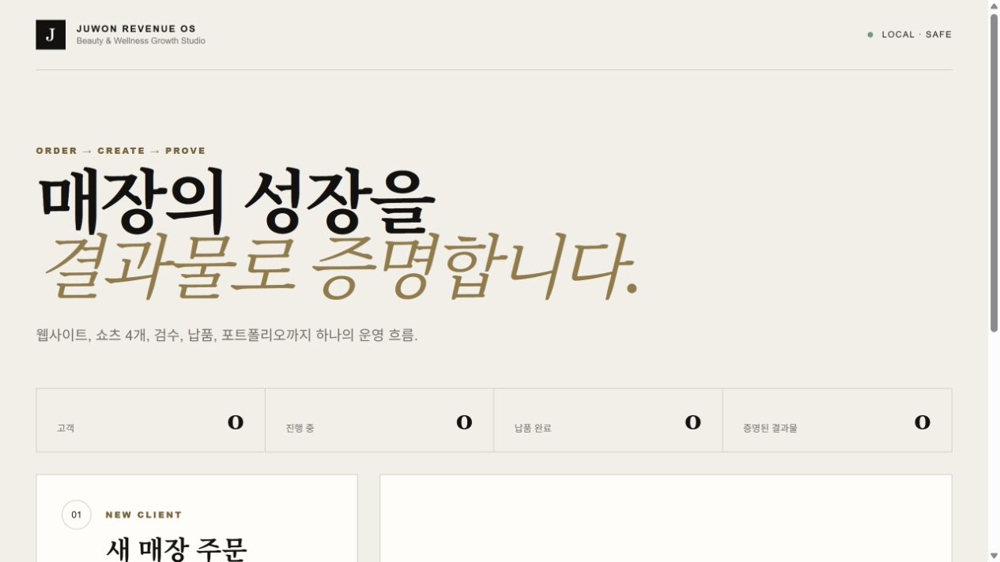

<!-- JUWON-PORTFOLIO-INTRO:START -->
# Juwon Revenue OS



*Recorded empty-order UI preview from an existing build. Customer data and backend not connected; production and delivery not exercised.*

*기존 빌드의 빈 주문 UI · 고객 데이터·백엔드 미연결 · 제작·납품 미실행*

## English

A local operations prototype for turning small-business orders into website drafts, short-video plans, review steps, and delivery ZIP packages. External publishing, payments, and messaging are not automatic.

[View JUWON's portfolio](https://jupt.pages.dev/) · [Browse the project collection](https://jupt.pages.dev/projects)

**Scope:** This README presents the repository's documented intent and recorded visual evidence. It does not certify that every feature is complete, deployed, or currently working. Follow the original setup, safety, and license documentation below.

This repository is a selected original-source snapshot. The recorded source fingerprint describes the initial publication; this portfolio introduction was added afterward. Original technical documentation is preserved below.

## 한국어

매장 주문을 웹사이트·쇼츠 기획·검수·납품 ZIP으로 연결하는 운영 웹앱.

[JUWON 포트폴리오 보기](https://jupt.pages.dev/) · [전체 프로젝트 보기](https://jupt.pages.dev/projects)

**확인 범위:** 저장소의 문서상 목적과 기록된 화면 근거를 소개합니다. 모든 기능의 완성·배포·현재 정상 작동을 보증하지 않습니다. 설치법·안전 주의사항·라이선스는 아래 기존 문서를 확인하세요.

선택된 원본 소스의 공개 스냅샷입니다. 기록된 소스 지문은 최초 공개 시점을 나타내며, 이 포트폴리오 소개는 이후 추가했습니다. 기존 기술 문서는 아래에 보존했습니다.
<!-- JUWON-PORTFOLIO-INTRO:END -->

---

## Original documentation / 기존 문서

# Juwon Revenue OS

미용·웰니스 소상공인의 주문을 웹사이트, 쇼츠 4개, SNS 문구, 승인, 납품 ZIP, 포트폴리오 사례로 바꾸는 로컬 운영체제입니다.

## 실행

```powershell
npm.cmd ci --ignore-scripts
npm.cmd run dev
```

브라우저에서 `http://127.0.0.1:10640`을 엽니다.

## 첫 고객 흐름

1. 매장명, 업종, 대표 서비스, 연락처, 예약 링크를 입력합니다.
2. `자동 제작 시작`을 눌러 웹사이트와 쇼츠 기획 4개를 생성합니다.
3. 결과물을 검수하고 `승인 요청`을 누릅니다.
4. 승인자가 현재 결과물 해시를 확인하고 최종 승인합니다.
5. `납품 패키지 만들기`로 체크섬 목록, ZIP, 사례 페이지를 생성합니다.

## 안전한 데모

개발 서버를 실행한 상태에서 다음 명령을 사용합니다.

```powershell
npm.cmd run rehearse
```

데모는 가상 매장만 생성하며 승인 대기 상태에서 멈춥니다. 외부 게시, 결제, 메시지 발송은 실행하지 않습니다.

## 검증

```powershell
npm.cmd test
npm.cmd run typecheck
npm.cmd run build
npm.cmd run e2e
```

## 기존 프로젝트 연결

Company OS는 `http://127.0.0.1:4877`의 상태만 읽습니다. 기존 Company OS 파일과 데이터는 수정하지 않습니다. Remotion 명령은 `BeautyShort` 구성과 주문별 결과 폴더만 허용하며 MVP에서는 자동 외부 게시를 하지 않습니다.
